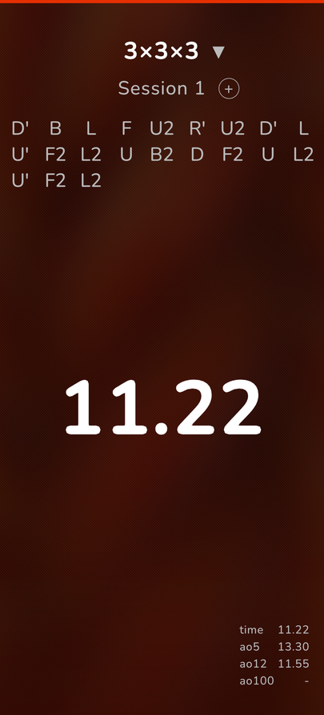
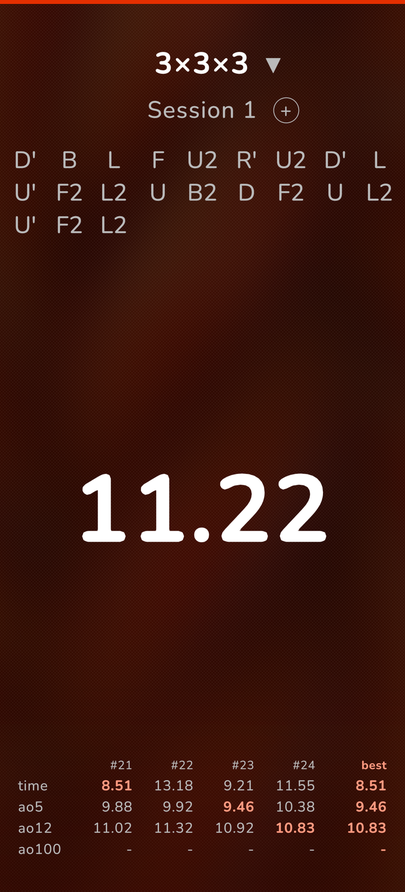

# Cube Timer

[English](README.md) | **繁體中文**

給 [Sailfish OS](https://sailfishos.org/) 用的速擰計時器，仿照 csTimer 的操作：按住開始、放開計時、
點一下停止。每次成績都存在手機裡，每個項目都有在手機上原生產生的隨機狀態打亂。

<p>
  
  
</p>

## 功能

- 按住開始：按住時變紅，準備好變綠，放開開始計時，點一下停止
- 13 個項目：2x2、3x3、4x4、5x5、6x6、7x7、3x3 單手、3x3 盲擰、Pyraminx、Skewb、Megaminx、Square-1、Clock
- 每個項目都有隨機狀態打亂，用 C++ 原生產生（見[打亂](#打亂)）
- 左右滑動打亂可以跳過或退回；長按可以複製
- 每個項目各自的 Session：新增、改名、切換、刪除
- 在下拉選單修改最後一筆成績：+2、DNF、刪除、OK
- 即時顯示最新成績、ao5、ao12、ao100；歷史表會標示 Session 內的最佳成績
- 完全離線：不用帳號、不連網、不需要特殊權限

## 安裝

Cube Timer 是給 Sailfish OS（aarch64）用的。Harbour 套件名稱是 `harbour-cubetimer`，每次發佈前都會用
Harbour RPM validator 驗證（目前版本 1.8-1）。

要在手機上從原始碼建置，需要 Sailfish 的用戶空間工具鏈（Qt 5.6、libsailfishapp）：

```sh
./build.sh                        # 編譯 bin/harbour-cubetimer（可用 SYSROOT=<路徑> 指定工具鏈）
rpm/harbour-cubetimer.spec        # 把已編譯的執行檔加上 share/ 打包成 RPM
```

`build.sh` 預設在儲存庫旁邊找 `../sysroot`，除非另外設定 `SYSROOT`。
`share/harbour-cubetimer/qml/` 底下的 QML 和 JavaScript 會在啟動時載入，所以只改介面不需要重新編譯。

## 打亂

`src/scramble/` 是 [csTimer](https://github.com/cs0x7f/cstimer)（commit `2547d82`）打亂產生器的 C++ 移植，
包含 Shuang Chen（cs0x7f）與貢獻者寫的 min2phase 3x3x3 求解器和 4x4x4 降階求解器。
使用同一個隨機種子時，輸出與 csTimer 完全相同，這是逐項目對照 csTimer 的 JavaScript 驗證過的。
這些打亂等同於 csTimer 的，**不是** WCA 自己的 TNoodle，所以請不要說成是官方 WCA 打亂。
Pyraminx 的隨機狀態篩選依照 WCA 規則 4b3f。

Square-1 和 Clock 的打亂還沒有人實際手動試玩過。

## 統計

ao5、ao12、ao100 會去掉視窗內最好和最差各 5 %（無條件進位），DNF 的處理依照一般規則。
WCA 本身沒有正式的 ao100，請稱為「WCA 風格的平均」。

## AI 輔助開發

Cube Timer 由 AI 助理（Hermy，帳號 `jollahermy`）與她的使用者合作完成，使用者負責指導方向並在真機上測試。
程式碼與文件有很大一部分是這樣產生的。原始碼以 GPL 公開，任何人都可以檢查這個 app 實際做了什麼。

## 授權

GPL-3.0，見 [LICENSE](LICENSE)。第三方程式碼：

- csTimer 打亂產生器與 min2phase（GPL-3.0），Shuang Chen（cs0x7f）與貢獻者
- ISAAC 亂數產生器，MIT 授權，Copyright (c) 2012 Yves-Marie K. Rinquin
- Nunito 字型，SIL Open Font License 1.1（`share/harbour-cubetimer/qml/fonts/OFL.txt`）
